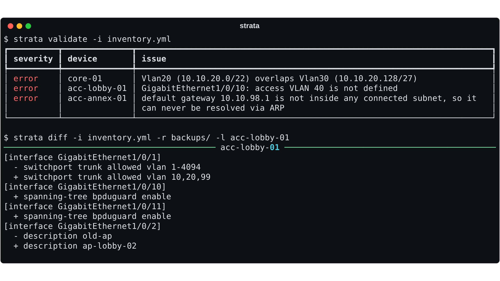

# Strata

[](https://github.com/Jamie-233/strata/actions/workflows/ci.yml)
[](LICENSE)
[](pyproject.toml)

**A network intent compiler.** Describe the network once in YAML — VLANs, ports, gateways, relay targets — and Strata validates it, compiles it into vendor configs for Cisco IOS and Huawei VRP, shows exactly what would change on each running device, and deploys it safely.

```
inventory.yml ──▶ validate ──▶ render ──▶ diff vs running ──▶ push (dry run by default)
   intent          semantics     IOS / VRP    per-section         parallel SSH, saved
```



## Why

Most small and mid-size networks are configured by hand, one switch at a time. That works until the day someone adds a guest VLAN to the core but forgets one access trunk, and a floor of access points loses guest Wi-Fi with no error anywhere. Strata treats the inventory as the single source of truth and the device configs as build artifacts, so that class of mistake is caught before anything touches a switch.

## Features

- **One source of truth** — `defaults → group → device` precedence, so per-site settings live in one place and a device only states what makes it different.
- **Multi-vendor rendering** — Cisco IOS and Huawei VRP from the same intent, including the places where their grammars quietly diverge (VLAN range syntax, mask notation, SVI naming, DHCP relay).
- **Semantic validation** — checks a template engine can't:
  - access ports or trunks referencing VLANs that don't exist
  - overlapping connected subnets on one device
  - duplicate addresses across the whole fleet
  - default gateways outside every connected subnet
  - native VLANs also carried tagged (VLAN-hopping exposure)
  - IOS-reserved VLANs 1002–1005
- **Structure-aware diff** — parses configs into a section tree, strips device-generated noise, and reports changes per interface instead of as a wall of `+`/`-` lines. Exits `3` on drift, so it can run on a schedule and alert when someone hand-edits a device.
- **Safe deploys** — `push` is a dry run unless `--apply` is given, refuses to run when validation fails, works through devices in parallel, and isolates per-device failures.
- **Fail loudly** — templates render with `StrictUndefined`; a missing variable stops the build instead of producing `ip address` with nothing after it.

## Quick start

```bash
pip install -e .            # rendering, validation, diff
pip install -e '.[ssh]'     # + backup / push over SSH (Netmiko)

strata validate -i examples/inventory.yml
strata render   -i examples/inventory.yml -o build/
```

Against real devices:

```bash
export STRATA_USERNAME=netops
export STRATA_PASSWORD='...'

strata backup -i inventory.yml -o backups/        # pull running configs
strata diff   -i inventory.yml -r backups/         # what would change
strata push   -i inventory.yml -l acc-lobby-01     # dry run
strata push   -i inventory.yml -l acc-lobby-01 --apply
```

Credentials are read only from the environment, never from the inventory, because the inventory is the file that gets committed, shared and pasted into tickets.

## Inventory

```yaml
defaults:
  dns_servers: [10.10.0.53]
  ntp_servers: [ntp.nict.jp]
  timezone: { name: JST, offset: 9 }

groups:
  access:
    platform: cisco_ios
    vlans:
      - { id: 10, name: STAFF }
      - { id: 20, name: GUEST }

devices:
  - hostname: acc-lobby-01
    group: access
    host: 10.10.99.11
    default_gateway: 10.10.99.1
    interfaces:
      - { name: Gi1/0/1, mode: trunk, native_vlan: 999, allowed_vlans: [10, 20], poe: true }
      - { name: Gi1/0/10, mode: access, vlan: 10 }
```

Interface modes: `access`, `trunk`, `routed`, `shutdown`. See [`examples/inventory.yml`](examples/inventory.yml) for a complete hotel network with a VRP core and IOS access layer.

### Example: diff output

```
[interface GigabitEthernet1/0/2]
  - description old-ap
  - switchport trunk allowed vlan 1-4094
  + description ap-lobby-02
  + switchport trunk allowed vlan 10,20,99
```

## Design notes

**Why compile instead of templating by hand?** A template only guarantees syntax. The expensive outages come from configs that are syntactically valid but semantically wrong, so validation runs on the intent model before rendering, where the relationships (this port → that VLAN → that SVI) are still explicit.

**Why a tree diff?** Devices reorder sections and inject timestamps; a line diff of two running configs is mostly noise, and `- shutdown` is meaningless without knowing which interface it came from. Indentation gives both IOS and VRP an implicit hierarchy, which the parser recovers in a single pass with an indent stack.

**Why lists replace instead of merge?** If a device's VLAN list were appended to its group's, there would be no way for one switch to *drop* a VLAN. Replacement keeps the effective config predictable from reading a single entry.

**Extending.** Add a vendor by dropping `<platform>.j2` into a directory passed with `--templates`. Add a validation rule by decorating a function with `@device_rule` or `@fleet_rule` in `validate.py`.

## Project layout

```
src/strata/
  inventory.py   intent model and precedence merge
  validate.py    per-device and fleet-wide rules
  render.py      Jinja2 environment, vendor filters
  diff.py        section-tree parser and diff
  devices.py     SSH backup/push, parallel runner
  cli.py         validate / render / diff / backup / push
  templates/     cisco_ios.j2, huawei_vrp.j2
```

## Development

```bash
pip install -e '.[dev]'
pytest
```

## License

MIT
